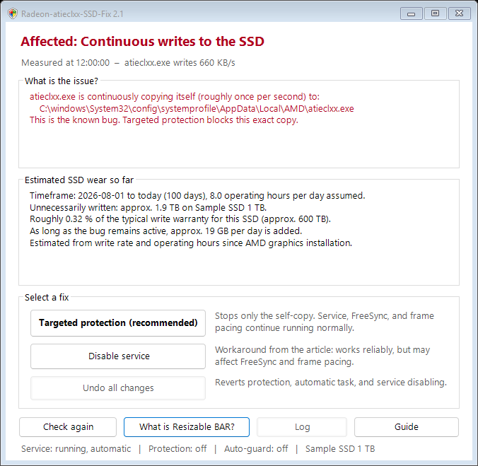
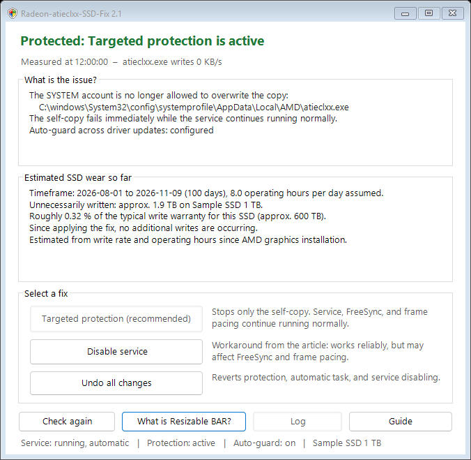

# Radeon-atieclxx-SSD-Fix

**Is the Radeon driver continuously writing to your SSD?** On affected drivers, `atieclxx.exe` (service "AMD External Events Utility") copies itself every second — roughly 56 GB per day. This tool checks whether your PC is affected, estimates the wear caused so far, and stops the continuous writes in a targeted way without disabling the service.

> **Note:** Unofficial workaround, not from AMD and not affiliated with AMD. Use at your own risk, without warranty or liability of any kind (see [LICENSE.txt](LICENSE.txt)).



*Sample view; all values shown are example values.*

## The Problem

On 2026-11-09, ComputerBase reported that the "AMD External Events Utility" service of the Radeon driver continuously writes to the system drive on many systems ([Article](https://www.computerbase.de/news/grafikkarten/schnelle-ssd-alterung-radeon-treiber-schreibt-fortwaehrend-daten-auf-die-ssd.100237/)). AMD has confirmed the bug; a fixed driver version is not yet available.

Measured with Event Tracing for Windows (ETW): on affected drivers, `atieclxx.exe` **copies itself every second** from the driver folder to

```
C:\Windows\System32\config\systemprofile\AppData\Local\AMD\atieclxx.exe
```

The file is around 660 KB in size, which amounts to roughly 56 GB per day of continuous operation. Afterward, the service looks for installation files of the filter driver `amdkmpfd` (Smart Access Memory). This explains why disabling Resizable BAR helps for some users.

## Download and Start

1. Download `Radeon-atieclxx-SSD-Fix.zip` from [**Releases**](../../releases/latest).
2. Extract the ZIP archive completely.
3. Double-click `START.cmd` and confirm the Windows prompt for administrator privileges with "Yes".

If Windows displays a warning ("Windows protected your PC"): click "More info" → "Run anyway". Alternatively, before extracting, right-click the ZIP file → Properties → check "Unblock".

## What the Program Does

- **Analysis:** measures whether and how heavily `atieclxx.exe` is writing, and shows which variant is present: self-copy to the known location, writing to another location, or not affected.
- **Wear estimate:** estimates how much data has already been written unnecessarily to the SSD (write rate × operating hours since the AMD graphics card was installed) and what percentage of a typical SSD write warranty (TBW) that represents.
- **Fix buttons:**

| Button | Effect |
|---|---|
| **Targeted protection** (recommended) | Denies only the SYSTEM account permission to overwrite this single copy. The copy attempt fails immediately, so nothing is written anymore. The service, FreeSync, frame pacing, and hotkeys remain untouched. Also sets up an automatic background task (see below). |
| **Disable service** | The workaround from the article. Always works, but may affect FreeSync and frame pacing. |
| **Undo all changes** | Reverts protection, automatic task, and service disabling. |

The program also explains the third option from the article — disabling Resizable BAR in the BIOS. That setting can only be changed in the BIOS itself.



*State after applying targeted protection, also shown with example values.*

### Automatic Protection Across Driver Updates

Targeted protection sets up the scheduled task "Radeon-atieclxx-SSD-Fix" in Windows Task Scheduler. It runs as SYSTEM 3 minutes after startup and every 30 minutes thereafter, and:

- re-applies the protection if a driver update has replaced the file,
- automatically checks after a driver change whether AMD has fixed the bug, and lifts the protection on its own if so,
- writes to the log file `C:\Program Files\Radeon-atieclxx-SSD-Fix\log.txt` only when events occur.

## Technical Details

- Protection: `icacls <Copy> /deny *S-1-5-18:(WD,AD,WEA,WA,DE)`, i.e., a Deny ACE solely for the SYSTEM account on that single file.
- The self-copy is detected via the USN of the NTFS change journal (`FSCTL_READ_FILE_USN_DATA`). File timestamps cannot be used for this because `CopyFile` preserves them from the source file. As a fallback, a short ETW trace (maximum 64 MB, deleted immediately) determines the write target.
- The measurement runs in the background while the window remains responsive.
- No downloads, no internet connection, no driver modifications, and no AMD files included in the package. The complete source code is in the [`Script`](Script) folder.

## Checking Status and Removing

| File | Purpose |
|---|---|
| `CHECK.cmd` | Status check and 10-second measurement, without admin rights |
| `REMOVE.cmd` | Reverts all changes and deletes the program folder |

After applying targeted protection, both files are also placed in `C:\Program Files\Radeon-atieclxx-SSD-Fix`.

## Alternative Without This Program

`Win+R` → `services.msc` → "AMD External Events Utility" → Stop, Startup type "Disabled". This is the workaround suggested in the article; it may affect FreeSync and frame pacing.

## Limitations

- Other driver versions may behave differently. The program therefore measures first and only intervenes if the fix is effective.
- The wear estimate is an approximation. Many SSDs do not report their power-on hours to Windows; in that case, 8 hours per day is assumed.
- On PCs where corporate policy only permits signed PowerShell scripts, the program will not start.
- On Windows Home, pop-up notifications from the background task are unavailable (`msg.exe` is missing on Windows Home). Everything is still recorded in the log.

## License and Trademarks

MIT License, see [LICENSE.txt](LICENSE.txt). AMD, Radeon, and Smart Access Memory are trademarks of Advanced Micro Devices, Inc. This project is not affiliated with AMD and is neither endorsed nor reviewed by AMD.

Original German version by [necanditool/Radeon-atieclxx-SSD-Fix](https://github.com/necanditool/Radeon-atieclxx-SSD-Fix).
